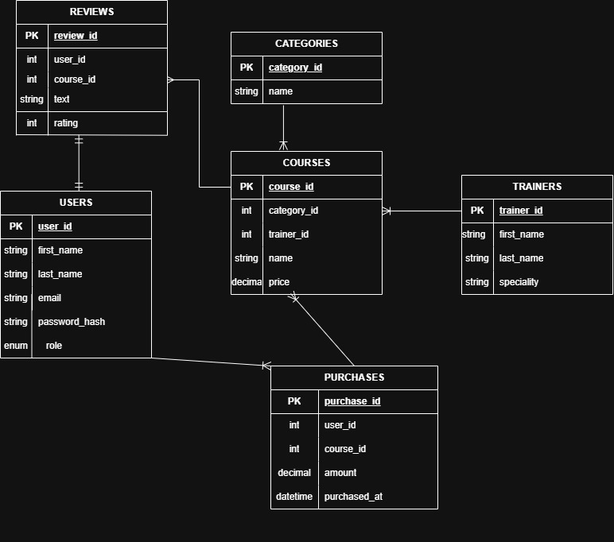

# Mentor

Mentor: Full-stack learning platform built as a Sigle Page Application. The platform provides regular users to browse courses, view trainers, read events, make course purchases and leave reviews. Administrators have access to a dedicated dashboard to manage users, courses, trainers, events and monitor websites.

Roles: admin, user. 

Entities: users, courses, categories, trainers, purchases, reviews.
 
## Technology stack
- Frontend: HTML, CSS, JavaScript, jQuery, Bootstrap 5, single-page application (SPA)
- Backend: PHP with FlightPHP (REST API), PDO, MySQL
- Local server: XAMPP
 
## Folder structure
- frontend/: css/, js/, views/ (one HTML file per view), assets/
- backend/: routes/, services/, dao/, middleware/, config/, logs/
- docs/: AI_LOG.md and other documentation

## Entity-Relationship Diagram

